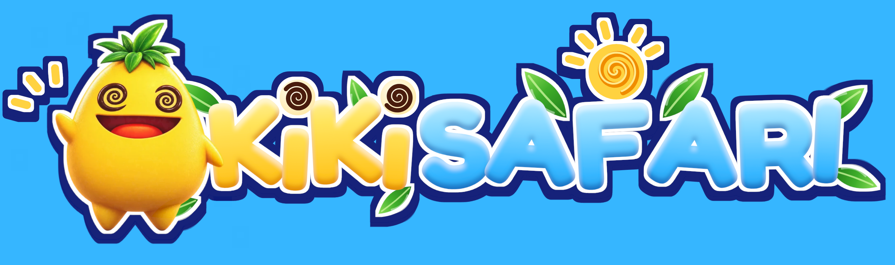
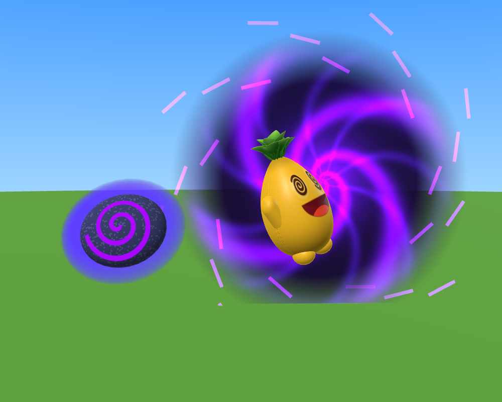

# KIKI SAFARI



An AR creature-collecting game starring **Kikiwawa ("Kiki")**, the Big Plush mascot. Find Kikis, flick a **Rune Stone**
at one, and a UV-purple portal sucks him in. Then the stone wobbles, and either he's caught or he breaks out with
"SO CLOSE!". Unity 6, AR Foundation (ARKit on iPhone, ARCore on Android).

Design direction: [`docs/DECISIONS.md`](docs/DECISIONS.md). Character canon: the Big Plush Character Treatment.

| | |
|---|---|
|  |  |

## Milestone 1: a complete Demo Safari AR catch on iPhone

What's in this first build:

- **Demo Safari map.** A fictional campground built from bundled GeoJSON: Sunny Meadow, Pine Hollow, the creek and Creek
  Footbridge, the Spiral Maze (Kiki's home spawn) and the Supply Tent. Tap to walk, drag to turn. There's a Nearby list
  within 200 m, Kikis show on the map within 70 m, and you can tap one to encounter it within 40 m. Supply stops give
  Rune Stones and have a cooldown per player.
- **Spawns** come from the same deterministic planner that Live Safari will use. It takes cells, time windows,
  habitats, night-only Moonbeam and rare Golden Spiral into account.
- **AR encounter.**
  - Kiki stands on a real floor (with LiDAR depth occlusion where the phone has it, people occlusion on A12+ phones).
  - The timing ring shows only the target size.
  - You flick from the bottom centre of the screen. Circling the stone first adds spin. Aim assist and
    **Tap to throw** are always available.
- **Catch sequence.** Hit sparkles, then the portal opens, sucks Kiki in and seals into the stone. The stone wobbles
  once for Common, twice for Rare and three times for Epic or Legendary. On a catch you get the reveal: the rarity
  stamp, Kiki drops onto a cosmic spiral and does one of five dances, the reward counts up (throw quality and spin
  bonus appear only here), and the screen waits for **Keep playing**. On a breakout the portal blasts open, you see
  "SO CLOSE!" and the screen shakes. On a miss the stone bounces and fizzles, with no text.
- **Kiki** is ported from the claw game's own `makeMascot()`: the egg body, chubby arms, feet, leaf fan, painted
  face and plush normal map. It's tuned toward the official art. The six variants change only the crown, embroidery
  and glow.
- **Feel.**
  - Sticker UI in the treatment's palette, with Lilita One and Baloo 2.
  - The treatment's seven haptics, native on iPhone and Android.
  - Chiptune blips, plus the real "yay" and "awww" clips from Big Plush.
  - Reduced motion follows the phone's setting. Sound can be turned off.
- **Hidden tuning panel.** Triple-tap the top-right corner to change throw strength, ring speed, aim assist, catch
  odds, gravity, hit size, force night and the debug overlay, live on the phone.
- **No AR? No problem.** In the editor without XR Simulation, or on a phone without AR, encounters use a meadow stand-in
  stage, so the full loop is always playable.

## Open it (Windows)

1. Install **Unity Hub** and **Unity 6 (6000.0 LTS)**, with **iOS Build Support** and **Android Build Support**.
2. In Unity Hub, choose Add → this folder. If Hub offers a newer 6000.0.x patch, take it.
3. On first open, **Kiki Safari ▸ Set Up Project** runs by itself. It:
   - sets the player settings
   - turns on ARKit, ARCore and XR Simulation
   - creates `Scenes/Main.unity` and the six variant assets
   - switches input handling to the Input System

   Unity then asks to restart once; say yes.
4. Press **Play**. You get the title screen, then the map. Walk to a Kiki and tap it.
   - To try real AR in the editor, turn on **XR Simulation** (Project Settings ▸ XR Plug-in Management ▸ Windows).
   - Without it, you get the meadow stage.

Getting it onto the iPhone: see **[docs/IPHONE-BUILDS.md](docs/IPHONE-BUILDS.md)**. It uses Unity Build Automation and
TestFlight, so no Mac is needed.

## Project layout

```
Assets/KikiSafari/
  Core/              engine-free C#: rules, spawns, catch maths, reveal timeline, save data, GeoJSON,
    Art/             Kiki's geometry and face painting (ported from the claw game), shared by game + previews
  Runtime/           Unity: GameRoot (boot + flow), AR stage, encounter, map, UI, haptics, sound
  Resources/         shaders, fonts (OFL), logo, official mascot + meadow art, voice clips, demo map, variants
  Plugins/iOS/       native haptics + Reduce Motion (Objective-C)
  Editor/            one-click project setup, UI texture import, iPhone build tweaks
  Tests/EditMode/    unit tests (run in Unity's Test Runner, or with dotnet)
tools/
  CoreTests/         run the same tests outside Unity:  dotnet test tools/CoreTests
  ArtPreview/        export Kiki's real meshes/textures and render them in a browser (three.js)
  logo/              the KIKI SAFARI logo source (SVG in HTML) and renderer
  mapgen/            regenerates the demo campground GeoJSON
docs/                decisions, iPhone build guide, brand images
```

Everything (screens, the AR rig, Kiki, the map) is built in code at runtime. The one scene only holds a `GameRoot`,
so there are no hand-made prefabs or scenes to get out of sync.

## Tests

```bash
dotnet test tools/CoreTests
```

37 tests cover the catch rules, wobble counts, reveal order (no spoilers, no text on a miss, Keep playing never
auto-closes), the Rune Stone and portal beats, spawn rules (night-only Moonbeam, habitats, Golden Spiral rarity and the
Crew Hunt boost, determinism), the speed lock, GPS checks, supply stop cooldowns, throw maths and the demo map. The
same files run in Unity's Test Runner (EditMode).

## Art previews

```bash
dotnet run --project tools/ArtPreview -- tools/ArtPreview/web/art
```

Serve `tools/ArtPreview/web` (for example `python -m http.server`) and open `index.html?scene=lineup`, `?scene=hero&v=pine`,
`?scene=stone` or `&night`. These render the exact meshes and textures the game builds.

## Not in this milestone

Live Safari (worldwide spawns from the server, Supabase sign-in, offline pending throws), Crew Hunts, field tasks,
routes and the leaderboard come later. The core rules for them are already in `Core/` and tested.
