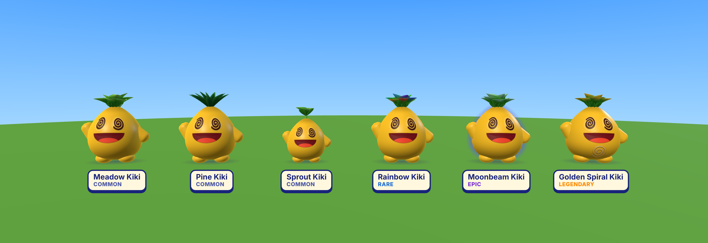
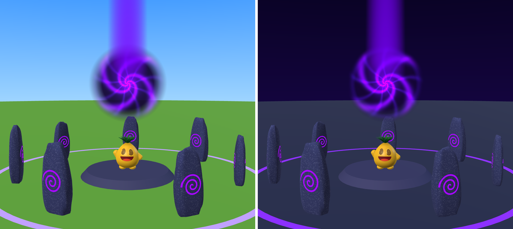
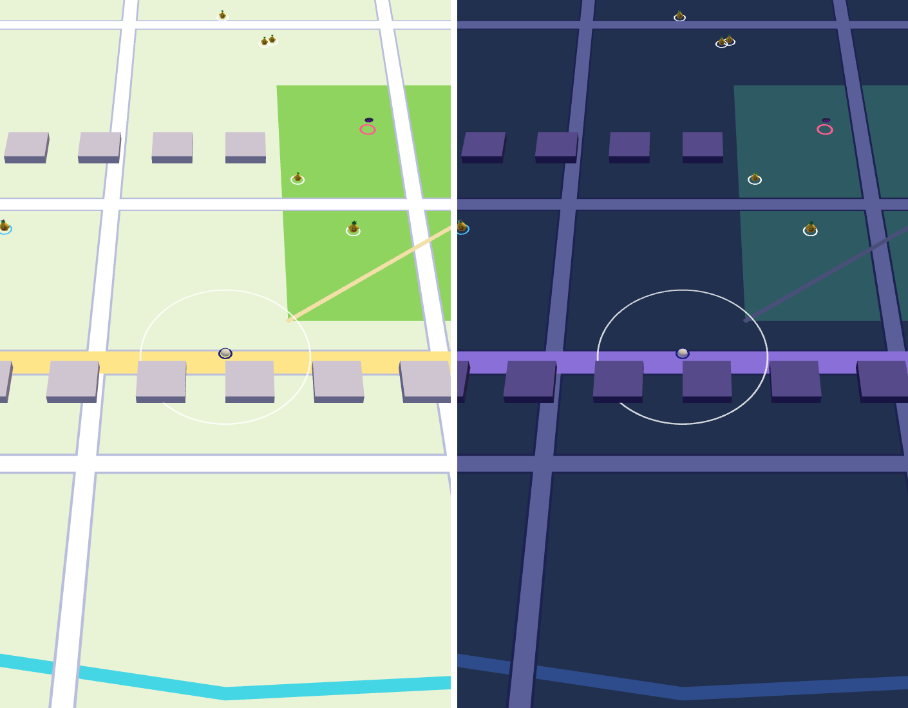

# KIKI SAFARI


A real-world AR creature-collecting game starring **Kikiwawa ("Kiki")**, the Big Plush mascot. Walk around with your
phone camera to find Kikis, supply stops and **Rune Circles** pinned at real places around you. Flick a **Rune Stone** at
a Kiki and a UV-purple portal sucks him in. Then the stone wobbles, and either he's caught or he breaks out with
"SO CLOSE!". Unity 6, AR Foundation (ARKit on iPhone, ARCore on Android).

Design direction: [`docs/DECISIONS.md`](docs/DECISIONS.md). Character canon: the Big Plush Character Treatment.

| | |
|---|---|
|  |  |

| | |
|---|---|
|  |  |

## What's built

- **Live Safari through the phone camera.** The main screen is the live camera. Kikis, supply stops and Rune Circles
  sit at their real GPS spots. AR tracking keeps them steady between GPS updates, and the compass lines the AR world up
  with true north.
  - **Radar:** a compass radar shows what's around, and the Nearby strip points to the nearest three things.
  - **Ranges:** you see things within 70 m (Rune Circles from much further, thanks to their light column) and can tap
    within 40 m.
  - **Safety:** above about 30 km/h there are no encounters, with a "Looks like you're moving fast" notice.
- **Everywhere.** Kikis spawn worldwide from a deterministic grid, so friends in the same place see the same Kikis.
  - Habitats rotate every two weeks.
  - Moonbeam appears only between local sunset and sunrise.
  - Supply stops are spread about every 250 m.
  - This needs no server yet; the server becomes the authority later.
- **Real landmarks, everywhere.** OpenStreetMap data loads around you, 800 m at a time, and is kept on the phone for
  two weeks so it works with weak signal.
  - The most notable landmarks become **Rune Circles**: historic sites, parks, public art, fountains, museums,
    libraries. Up to three per area, spaced at least 250 m apart. Other landmarks become **supply stops**.
  - Quiet areas still get a stop every 250 m and a circle in the nearest green space, so the countryside works too.
  - The decisions doc's safety rules apply: nothing in roads, railways, water or buildings, and nothing in or near
    schools, hospitals, places of worship, cemeteries, memorials, military sites, prisons or airports.
  - Habitats come from real land cover: parks favour Meadow, woods favour Pine, and water favours Rainbow.
- **Street map.** Tap **Map** to see your real streets in the sticker style, with you, the Kikis, stops and Rune Circles
  on it. Drag to turn, pinch to zoom, tap anything within 40 m. The camera switches off in map mode to save battery.
  The map credits "© OpenStreetMap contributors", as the data's licence requires.
- **Rune Circles** (instead of gyms): seven carved standing stones around a dais, with a Keeper Kiki, a swirling portal
  and a column of UV light you can spot down the street.
  - **Spiral Rite:** tap as each ring of light lands on the circle's spiral rune. Out-attune the Keeper and your Kiki
    takes the circle, gathering Sprouts while it holds it.
  - **Portal Surges:** every 2 hours, for 15 minutes, rarer Kikis pour out of the portal for everyone nearby, and Golden
    Spiral is likelier.
- **Plus a test Rune Circle at home.** The first time the game gets a good GPS fix, it pins an extra circle a few
  metres in front of you, with a supply stop beside it. You can switch it off in the tuning panel. A Kiki always wanders near it, so there's something to catch
  at home. The spot is saved only on the phone. To move it, open the hidden tuning panel (triple-tap the top-right
  corner) and tap **Move test Rune Circle here**.
- **AR catch with the Rune Stone.**
  - The timing ring shows only the target size.
  - You flick from the bottom centre of the screen. Circling the stone first adds spin. Aim assist and
    **Tap to throw** are always available.
  - On a hit, the portal sucks Kiki in and seals into the stone. The stone wobbles 1–3 times by rarity, then either
    bursts into the reveal or blasts open with "SO CLOSE!".
  - The reveal: the rarity stamp, Kiki drops onto a cosmic spiral and does one of five dances, the reward counts up,
    and the screen waits for **Keep playing**.
- **Kiki** is ported from the claw game's own `makeMascot()` and tuned toward the official art. The six variants change
  only the crown, embroidery and glow.
- **Feel.** Sticker UI, the treatment's seven haptics (native on iPhone and Android), chiptune blips plus the real
  "yay" and "awww" clips, reduced motion and a sound toggle.
- **Practice campground.** A fictional map for when there's no location, and for players under the digital age of
  consent.

## Playing in the editor

Press **Play**, then **Play** on the title screen.
- **Location:** simulated. **WASD** or the arrow keys walk (hold **Shift** to run), and **Q** and **E** turn.
- **No phone camera:** you see a meadow stand-in that turns as you do.
- **Real AR in the editor:** turn on XR Simulation (Project Settings ▸ XR Plug-in Management ▸ Windows).

## Play it on your iPhone (web version, no App Store needed)

The `web/` folder is a complete web version that runs in Safari and installs to your Home Screen like Big Plush.

1. In Netlify, choose **Add new site ▸ Import an existing project ▸ GitHub** and pick this repo. The `netlify.toml`
   at the top of the repo already tells Netlify to publish `web/`, so just press **Deploy**.
2. On your iPhone, open the site in **Safari** and tap **Play ▸ Allow and play** (camera, motion and location).
3. To make it an app: **Share ▸ Add to Home Screen**.

On a computer you can try it too: there's no camera or motion there, so you get a meadow stand-in. Drag to look
around, WASD walks. Add `?lat=…&lon=…` to the address to start somewhere specific.

Run the web tests with `node web/test/core.test.mjs`.

## Open it (Windows)

1. Install **Unity Hub** and **Unity 6 (6000.0 LTS)**, with **iOS Build Support** and **Android Build Support**.
2. In Unity Hub, choose Add → this folder. If Hub offers a newer 6000.0.x patch, take it.
3. On first open, **Kiki Safari ▸ Set Up Project** runs by itself. It:
   - sets the player settings
   - turns on ARKit, ARCore and XR Simulation
   - creates `Scenes/Main.unity` and the six variant assets
   - switches input handling to the Input System

   Unity then asks to restart once; say yes.
4. Press **Play** (see "Playing in the editor" above).

Getting it onto the iPhone: see **[docs/IPHONE-BUILDS.md](docs/IPHONE-BUILDS.md)**. It uses Unity Build Automation and
TestFlight, so no Mac is needed.

## Project layout

```
Assets/KikiSafari/
  Core/              engine-free C#: rules, spawns, catch maths, reveal timeline, save data, GeoJSON,
    Art/             Kiki's geometry and face painting (ported from the claw game), shared by game + previews
  Runtime/           Unity: GameRoot (boot + flow), AR stage, encounter, map, UI, haptics, sound
  Resources/         shaders, fonts (OFL), logo, official mascot + meadow art, voice clips, demo map, variants
  Plugins/iOS/       native haptics + Reduce Motion (Objective-C)
  Editor/            one-click project setup, UI texture import, iPhone build tweaks
  Tests/EditMode/    unit tests (run in Unity's Test Runner, or with dotnet)
tools/
  CoreTests/         run the same tests outside Unity:  dotnet test tools/CoreTests
  ArtPreview/        export Kiki's real meshes/textures and render them in a browser (three.js)
  logo/              the KIKI SAFARI logo source (SVG in HTML) and renderer
  mapgen/            regenerates the demo campground GeoJSON
docs/                decisions, iPhone build guide, brand images
```

Everything (screens, the AR rig, Kiki, the map) is built in code at runtime. The one scene only holds a `GameRoot`,
so there are no hand-made prefabs or scenes to get out of sync.

## Tests

```bash
dotnet test tools/CoreTests
```

61 tests cover:
- **Catching:** the catch rules, wobble counts, and the reveal order (no spoilers, no text on a miss, Keep playing never
  auto-closes), including the Rune Stone and portal beats.
- **Spawning:** night-only Moonbeam, habitats, Golden Spiral rarity, Surge boosts and determinism.
- **The real world:** the worldwide grid, GPS-to-metres maths and bearings, local sunset and sunrise, the speed lock and
  GPS checks.
- **Rune Circles:** the circle's wanderer Kiki, Portal Surges, Spiral Rite timing and scoring, and Keepers' Sprouts.
- **Map data:** reading OpenStreetMap data, the safety rules (including a school with art inside it and a statue
  beside a church), land-cover habitats, and landmark placement (spacing, coverage, determinism). These use a
  made-up neighbourhood in the exact format the live service returns.
- **Everything else:** supply stop cooldowns, throw maths and the practice map. The
same files run in Unity's Test Runner (EditMode).

## Art previews

```bash
dotnet run --project tools/ArtPreview -- tools/ArtPreview/web/art
```

Serve `tools/ArtPreview/web` (for example `python -m http.server`) and open `index.html?scene=lineup`, `?scene=hero&v=pine`,
`?scene=stone` or `&night`. These render the exact meshes and textures the game builds.

## Next

- **The server.** Supabase sign-in, server-checked catches and shared Keepers (today a captured circle is remembered on
  the phone), plus offline pending throws.
- **Self-hosted map data for launch.** Development uses the free public Overpass service, which is fine for testing but
  not for a big launch. One endpoint constant in `OsmLoader.cs` switches it.
